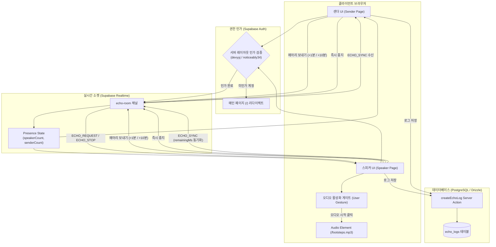
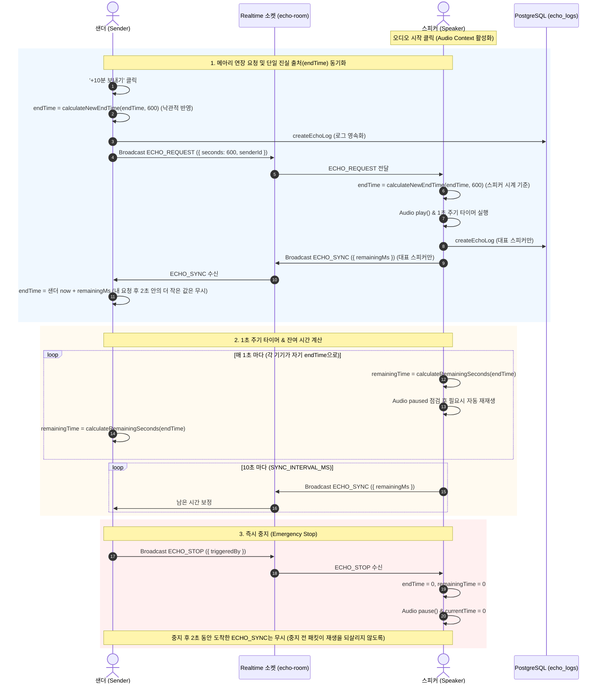

# 메아리 (Echo) - 상세 비즈니스 로직 및 기능 명세 (v2.2)

## 1. 개요
'메아리(Echo)'는 사용자 간의 실시간 역할 기반 사운드 연장 및 브로드캐스트 상호작용 서비스입니다. 
접근 권한이 부여된 사용자(허용된 이메일 계정)가 **스피커(Speaker)** 또는 **샌더(Sender)** 역할로 참여하여 실시간 소켓 통신을 통해 사운드 재생 시간을 연장하고 동기화합니다.

> 2026-11-12부터 사이트 메뉴·푸터에 에코 링크가 없습니다. 허용 계정으로 로그인한 뒤 주소(`/echo`)를 직접 입력해 들어갑니다. 검색엔진에 나오지 않도록 `app/echo/layout.tsx`에서 `noindex`를 겁니다. 허용 계정 검사는 그대로입니다.

각 기기는 자기 시계 기준 종료 시각(**`endTime`**, Unix ms)으로 카운트다운합니다. v2.2부터 기기 사이에는 종료 시각 대신 **남은 시간(`remainingMs`)**을 주고받고, 받은 기기가 자기 시계로 종료 시각을 다시 계산하므로 기기 간 시계 차이가 결과에 영향을 주지 않습니다.

---

## 2. 권한 및 접근 제어 (Authorization)

### 2.1. 사용자 인가 (Allowed Users)
- **인가된 이메일 목록**: `devyyj@gmail.com`, `noticeably34@gmail.com`
  - 목록은 `utils/echo-access.ts`(`ECHO_ALLOWED_EMAILS`, `isEchoAllowedEmail`) 한 곳에서 관리하며, 메뉴 노출·페이지·서버 액션이 모두 이 함수를 사용합니다. 대소문자와 앞뒤 공백은 무시합니다.
- **페이지 접근 (서버 검증)**: `app/echo/layout.tsx`(Server Component)가 랜딩(`/echo`), 스피커(`/echo/speaker`), 샌더(`/echo/sender`) 렌더링 전에 Supabase Auth(`auth.getUser()`)로 검증합니다.
- **미인가 처리**: 비로그인 사용자 또는 허용되지 않은 계정은 페이지가 그려지기 전에 메인 페이지(`/`)로 리다이렉트됩니다.
- **서버 액션 검증**: 서버 액션은 공개 엔드포인트이므로 `createEchoLog`, `getEchoLogs`도 호출자를 직접 검증하고, 미인가 시 `{ success: false, error: 'Unauthorized' }`를 반환합니다.
- **입력 제한**: 로그 메시지는 공백 제거 후 1~500자만 저장하고(`Invalid log`), 로그 조회 개수는 1~100개로 제한합니다.

### 2.2. v2.1 보완 이력 (2026-10-17)
| 문제 | 원인 | 조치 |
|---|---|---|
| 미인가 사용자가 빈 화면에 갇힘 | 클라이언트 `useEffect` 안에서 `redirect()`를 호출해 실제 이동이 일어나지 않음 | 서버 레이아웃 가드로 이전, 페이지별 중복 권한 코드 제거 |
| 로그 서버 액션 무인증 | 서버 액션에 권한 검사 없음 (누구나 로그 조회·기록 가능) | 허용 계정 검증 + 입력 길이·조회 개수 제한 |
| 퇴장 로그 중복 | 퇴장을 관찰한 모든 접속자가 DB 저장·브로드캐스트 | 퇴장 로그는 각자 화면에만 기록(`addLocalLog`) |
| 재생 시작 로그 중복 | 요청 처리기와 타이머 effect가 각각 기록 | 타이머 effect의 시작 로그 제거 |
| 하트비트·동기화 질의 중복 | 훅의 15초 하트비트·`ECHO_QUERY`를 페이지에서 한 번 더 전송 | 스피커 30초 하트비트, 샌더 재연결 `ECHO_QUERY` effect 제거 |

### 2.3. v2.2 보완 이력 (2026-11-11)
| 문제 | 원인 | 조치 |
|---|---|---|
| 샌더 남은 시간이 시계 차이만큼 틀림 | 서로 다른 기기 시계의 종료 시각을 직접 비교하고 더 큰 값만 받아들임 | 남은 시간(ms)만 주고받고 받은 쪽 시계로 환산(`app/echo/utils/echo-sync.ts`). 샌더는 스피커 값을 항상 따르되 내 요청 직후 2초 안의 더 작은 값만 무시 |
| 중지 시 "완료" 로그가 함께 남음, 스피커 수만큼 로그 중복 | 재생 종료 effect가 중지·완료를 구분하지 않고, 스피커마다 저장 | 완료 로그는 시간이 다 된 경우에만, 재생·완료 로그는 대표 스피커(접속 ID 사전순 첫 번째) 한 대만 저장 |
| 테스트가 실제 코드를 검증하지 않음 | 통합 테스트가 쓰이지 않는 옛 함수로 동작을 흉내 냄 | 미사용 함수 삭제, 시계 차이·다중 스피커·지연 패킷을 실제 동기화 함수로 검증하는 통합 테스트로 교체 |
| 소리가 안 나는 스피커가 인원에 잡힘 | 오디오 활성화 전에 채널 접속 | 오디오를 켠 뒤에만 접속(`useEchoSocket`의 `enabled`) |
| 휴대폰 스피커가 화면이 꺼지면 멈춤 | 화면 잠금 시 탭이 중단됨 | 재생 중 Wake Lock 유지(`useWakeLock`), 탭이 다시 보이면 재요청 |
| 네트워크가 잠깐 느려지면 소리가 처음부터 다시 재생 | `stalled` 이벤트에서 재생 위치를 0으로 되돌림 | `stalled` 처리 제거, 실제 멈춤은 Watchdog이 복구 |
| 접속자 ID 서버·브라우저 렌더링 불일치 | 렌더링 중 `sessionStorage`를 읽음 | `usePresenceId` 훅으로 마운트 후 읽기, 세 페이지 공통 사용 |
| 메시지 과다 | 스피커마다 1초마다 동기화, 15초 연결 유지 신호 별도 전송 | 동기화는 변경 시와 10초 간격, 연결 유지는 Supabase 클라이언트 기본(25초)에 맡김 |
| 로그 테이블 무한 증가 | 연결·재연결 기록까지 모두 저장, 삭제 규칙 없음 | 연결 성공·재연결 안내는 화면에만 표시, 저장 시 30일 지난 로그 삭제 |
| 중복 코드 | 첫 화면이 채널 접속 코드를 따로 구현 | 첫 화면도 `useEchoSocket`(`role: 'landing'`, 로그 미조회) 사용 |
| 접속 직후 "채널 오류 발생: 알 수 없는 오류" 반복 (2026-11-12) | 이전 채널을 지우면 라이브러리가 웹소켓을 끊기 시작하는데, 다 끊기기 전에 새 채널을 구독해 닫히는 순간 오류 정보 없는 `CHANNEL_ERROR` 발생 후 5초 대기 | 이전 소켓이 다 닫힐 때까지(최대 3초) 기다린 뒤 구독. 오류 정보 없는 `CHANNEL_ERROR`는 연결 끊김으로 보고 화면에만 안내 후 1초부터 늘려 가며 재접속 |

---

## 3. 전체 시스템 비즈니스 로직 구성도 (Mermaid Diagrams)

### 3.1. 전체 시스템 아키텍처 및 접속 흐름도 (Flowchart)

### 3.2. 실시간 소켓 이벤트 및 연장 시퀀스 (Sequence Diagram)

---

## 4. 핵심 비즈니스 로직 및 역할 정의 (v2.2)

### 4.1. 남은 시간 계산과 기기 간 동기화
각 기기의 카운트다운은 자기 시계 기준 **`endTime` (Unix epoch ms)**으로 계산합니다 (`app/echo/utils/echo-logic.ts`):

1. **`calculateRemainingSeconds(endTime, nowMs)`**:
   $$\text{remainingTime} = \max\left(0, \left\lceil \frac{\text{endTime} - \text{nowMs}}{1000} \right\rceil\right)$$
2. **`calculateNewEndTime(currentEndTime, addedSeconds, nowMs)`**:
   $$\text{newEndTime} = \max(\text{currentEndTime}, \text{nowMs}) + \text{addedSeconds} \times 1000$$

기기 간 동기화 규칙은 `app/echo/utils/echo-sync.ts`에 있습니다.
- **`ECHO_SYNC`는 `remainingMs`만 보냅니다.** 받은 기기는 `endTime = 내 now + remainingMs`로 환산합니다.
- **샌더 (`resolveSenderEndTime`)**: 스피커 값을 항상 따릅니다. 단, 내 요청 후 2초(`OWN_REQUEST_GRACE_MS`) 안에 도착한 더 작은 값은 요청 전에 출발한 패킷으로 보고 무시합니다.
- **스피커끼리 (`resolveSpeakerEndTime`)**: 재생 중이 아니면 받은 값을 따르고, 재생 중이면 1.5초 넘게 더 클 때만 따릅니다 (서로 값을 주고받으며 흔들리지 않도록).
- **중지 직후 (`isWithinStopGrace`)**: 중지 후 2초 동안은 `ECHO_SYNC`를 무시합니다.
- **대표 스피커 (`isLogLeader`)**: 스피커가 여러 대면 접속 ID 사전순 첫 번째 스피커만 재생·완료 로그를 저장하고, 요청 수신 직후 동기화를 보냅니다.

### 4.2. 역할 (Roles)

#### 1) 스피커 (Speaker) - `/echo/speaker`
- **주요 역할**: 실시간 배경 사운드(`/public/footsteps.mp3`)를 재생하는 오디오 주체.
- **접속 시점**: "오디오 시작하기"를 눌러 소리를 켠 뒤에 채널에 접속하므로, 접속 인원의 스피커 수는 실제로 소리가 나는 스피커 수입니다.
- **요청 처리 (`ECHO_REQUEST`)**:
  - `addedSeconds` (+60초 / +600초) 수신 시 `calculateNewEndTime`을 호출하여 `endTime`을 즉시 갱신합니다.
- **동기화 송출 (`ECHO_SYNC`)**:
  - 값이 바뀔 때(직접 보냄·완료·`ECHO_QUERY` 응답, 요청 수신 시 대표 스피커)와 재생 중 10초마다 `remainingMs`를 브로드캐스트합니다.
- **화면 꺼짐 방지**: 재생 중에는 Wake Lock으로 화면을 켜 둡니다 (지원 브라우저만).

#### 2) 샌더 (Sender) - `/echo/sender`
- **주요 역할**: 스피커에게 사운드 연장 요청을 보내는 제어 주체.
- **낙관적 업데이트 및 동기화**:
  - 클릭 즉시 `calculateNewEndTime`으로 로컬 `endTime`을 갱신하고 UI를 즉시 업데이트합니다.
  - 다른 사람의 `ECHO_REQUEST`도 낙관적으로 반영하고, 수신된 `ECHO_SYNC`의 `remainingMs`로 보정합니다.

---

## 5. 실시간 소켓 통신 명세 (`useEchoSocket` Hook)

| 이벤트명 | 발신 주체 | 페이로드 | 목적 및 효과 |
|---|---|---|---|
| `ECHO_REQUEST` | Sender / Speaker | `{ senderId, seconds }` | 재생 시간 추가 요청 (+60초 또는 +600초) |
| `ECHO_SYNC` | Speaker | `{ remainingMs }` | 남은 시간(ms). 받은 기기가 자기 시계로 종료 시각 환산. 변경 시 + 재생 중 10초마다 |
| `ECHO_QUERY` | Sender / Speaker (채널 구독 성공 시마다) | `{ requesterId }` | 재생 중인 스피커에게 현재 남은 시간 요구 (재연결 포함) |
| `ECHO_STOP` | Sender / Speaker | `{ triggeredBy }` | 모든 재생 즉시 중단 및 `endTime = 0` 초기화 |
| `LOG_EVENT` | Sender / Speaker | `{ id, timestamp, message, eventType, userId }` | 실시간 로그 UI 동기화 (퇴장·연결 상태 로그는 전파하지 않음) |

연결 유지 신호는 Supabase 클라이언트가 25초마다 자체 전송하므로 별도 이벤트를 보내지 않습니다.

### 5.1. 로그 저장 규칙
- **DB 저장 + 전파**: 메아리 보냄·중지·퇴장(직접 나가기), 재생·완료(대표 스피커만), 서버가 이유를 알려 준 채널 오류, 재접속 한도 초과.
- **내 화면에만 표시**: 서버 연결 성공, 재연결 안내(오류 정보 없는 `CHANNEL_ERROR` 포함), 다른 사용자의 연결 끊김 퇴장.
- **보관 기간**: 로그를 저장할 때 30일이 지난 로그를 함께 삭제합니다.

---

## 6. 검증 및 테스트 체계

본 시스템은 **Red-Green-Refactor TDD** 원칙을 준수하며 다음 테스트 수트를 전수 통과합니다:

1. **단위 테스트 (`app/echo/utils/echo-logic.test.ts`, `app/echo/utils/echo-sync.test.ts`)**:
   - `calculateRemainingSeconds`, `calculateNewEndTime`, `formatTime`, `parseSeconds` 검증.
   - 남은 시간 환산, 샌더·스피커 동기화 규칙, 중지 직후 유예, 대표 스피커 선정 검증.
2. **샌더-스피커 동기화 통합 테스트 (`app/echo/integration.test.ts`)**:
   - 기기 시계 차이(최대 9분), 요청 직후 지연 패킷, 늦게 들어온 스피커, 여러 스피커 동시 처리에서 남은 시간이 일치하는지 검증.
3. **서버 액션 및 DB 통합 테스트 (`app/actions/echo.test.ts`, `app/echo/db-integration.test.ts`)**:
   - PostgreSQL DB와의 `echo_logs` 이벤트 기록 검증.
   - 비로그인·미허용 계정 차단, 메시지 길이·조회 개수 제한 검증.
4. **접근 제어 테스트 (`app/echo/layout.test.tsx`, `utils/echo-access.test.ts`)**:
   - 허용 계정만 렌더링, 비로그인·미허용 계정은 `/`로 리다이렉트.
5. **훅 테스트 (`app/echo/hooks/*.test.ts`)**:
   - 동시 구독 정리, 퇴장·연결 로그의 로컬 전용 기록, `enabled` 전 미접속, 연결 유지 신호 미전송, 스피커 ID 목록, 첫 화면 로그 미조회.
   - `usePresenceId`: 서버 렌더링과 첫 렌더링 일치, 저장·재사용.
   - `useWakeLock`: 재생 중 요청·해제, 탭 복귀 시 재요청, 미지원 브라우저.

