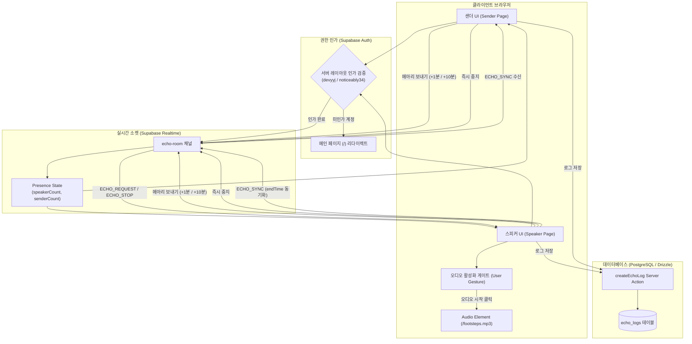
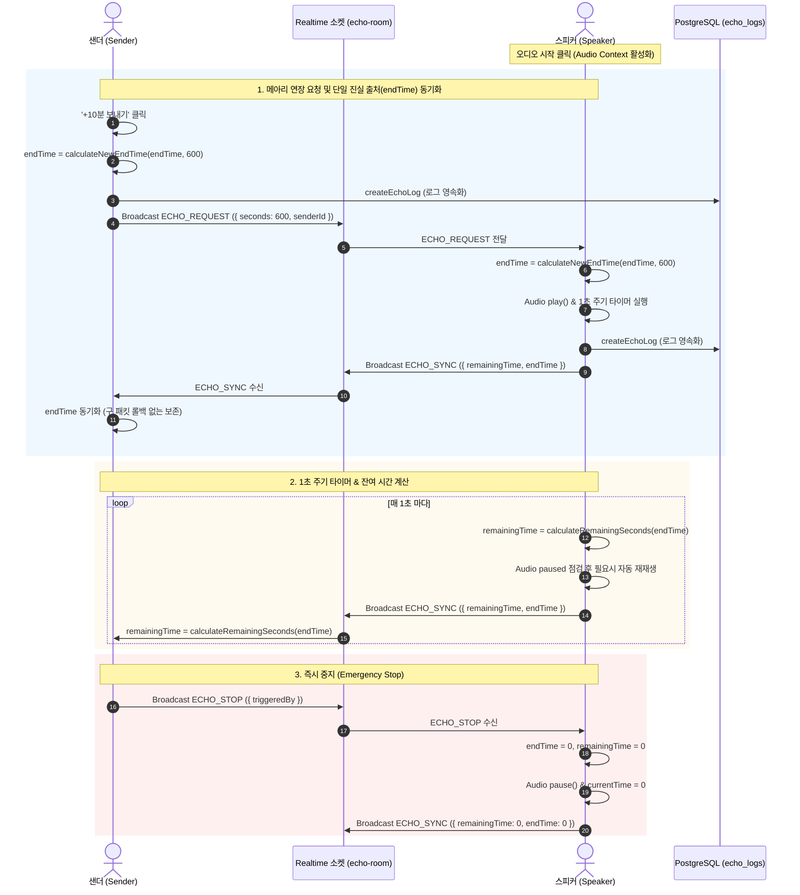

# 메아리 (Echo) - 상세 비즈니스 로직 및 기능 명세 (v2.1)

## 1. 개요
'메아리(Echo)'는 사용자 간의 실시간 역할 기반 사운드 연장 및 브로드캐스트 상호작용 서비스입니다. 
접근 권한이 부여된 사용자(허용된 이메일 계정)가 **스피커(Speaker)** 또는 **샌더(Sender)** 역할로 참여하여 실시간 소켓 통신을 통해 사운드 재생 시간을 연장하고 동기화합니다.

v2.0부터는 종료 절대 시각(**`endTime`**: Unix ms epoch timestamp)을 **단일 진실 출처(Single Source of Truth)**로 채택하여 시계 불일치, 네트워크 지연 및 롤백 문제를 근본적으로 해결하고 비즈니스 로직을 대폭 효율화하였습니다.

---

## 2. 권한 및 접근 제어 (Authorization)

### 2.1. 사용자 인가 (Allowed Users)
- **인가된 이메일 목록**: `devyyj@gmail.com`, `noticeably34@gmail.com`
  - 목록은 `utils/echo-access.ts`(`ECHO_ALLOWED_EMAILS`, `isEchoAllowedEmail`) 한 곳에서 관리하며, 메뉴 노출·페이지·서버 액션이 모두 이 함수를 사용합니다. 대소문자와 앞뒤 공백은 무시합니다.
- **페이지 접근 (서버 검증)**: `app/echo/layout.tsx`(Server Component)가 랜딩(`/echo`), 스피커(`/echo/speaker`), 샌더(`/echo/sender`) 렌더링 전에 Supabase Auth(`auth.getUser()`)로 검증합니다.
- **미인가 처리**: 비로그인 사용자 또는 허용되지 않은 계정은 페이지가 그려지기 전에 메인 페이지(`/`)로 리다이렉트됩니다.
- **서버 액션 검증**: 서버 액션은 공개 엔드포인트이므로 `createEchoLog`, `getEchoLogs`도 호출자를 직접 검증하고, 미인가 시 `{ success: false, error: 'Unauthorized' }`를 반환합니다.
- **입력 제한**: 로그 메시지는 공백 제거 후 1~500자만 저장하고(`Invalid log`), 로그 조회 개수는 1~100개로 제한합니다.

### 2.2. v2.1 보완 이력 (2026-10-17)
| 문제 | 원인 | 조치 |
|---|---|---|
| 미인가 사용자가 빈 화면에 갇힘 | 클라이언트 `useEffect` 안에서 `redirect()`를 호출해 실제 이동이 일어나지 않음 | 서버 레이아웃 가드로 이전, 페이지별 중복 권한 코드 제거 |
| 로그 서버 액션 무인증 | 서버 액션에 권한 검사 없음 (누구나 로그 조회·기록 가능) | 허용 계정 검증 + 입력 길이·조회 개수 제한 |
| 퇴장 로그 중복 | 퇴장을 관찰한 모든 접속자가 DB 저장·브로드캐스트 | 퇴장 로그는 각자 화면에만 기록(`addLocalLog`) |
| 재생 시작 로그 중복 | 요청 처리기와 타이머 effect가 각각 기록 | 타이머 effect의 시작 로그 제거 |
| 하트비트·동기화 질의 중복 | 훅의 15초 하트비트·`ECHO_QUERY`를 페이지에서 한 번 더 전송 | 스피커 30초 하트비트, 샌더 재연결 `ECHO_QUERY` effect 제거 |

---

## 3. 전체 시스템 비즈니스 로직 구성도 (Mermaid Diagrams)

### 3.1. 전체 시스템 아키텍처 및 접속 흐름도 (Flowchart)

### 3.2. 실시간 소켓 이벤트 및 연장 시퀀스 (Sequence Diagram)

---

## 4. 핵심 비즈니스 로직 및 역할 정의 (v2.0)

### 4.1. 단일 진실 출처 (Single Source of Truth) 방정식
모든 카운트다운과 남은 시간 계산은 절대 시각 **`endTime` (Unix epoch ms)** 1가지로 귀결되며 다음 2개의 pure function으로 다루어집니다:

1. **`calculateRemainingSeconds(endTime, nowMs)`**:
   $$\text{remainingTime} = \max\left(0, \left\lceil \frac{\text{endTime} - \text{nowMs}}{1000} \right\rceil\right)$$
2. **`calculateNewEndTime(currentEndTime, addedSeconds, nowMs)`**:
   $$\text{newEndTime} = \max(\text{currentEndTime}, \text{nowMs}) + \text{addedSeconds} \times 1000$$

### 4.2. 역할 (Roles)

#### 1) 스피커 (Speaker) - `/echo/speaker`
- **주요 역할**: 실시간 배경 사운드(`/public/footsteps.mp3`)를 재생하는 오디오 주체.
- **요청 처리 (`ECHO_REQUEST`)**:
  - `addedSeconds` (+60초 / +600초) 수신 시 `calculateNewEndTime`을 호출하여 `endTime`을 즉시 갱신합니다.
- **동기화 송출 (`ECHO_SYNC`)**:
  - 1초마다 최신 `endTime`과 `remainingTime`을 브로드캐스트합니다.

#### 2) 샌더 (Sender) - `/echo/sender`
- **주요 역할**: 스피커에게 사운드 연장 요청을 보내는 제어 주체.
- **낙관적 업데이트 및 동기화**:
  - 클릭 즉시 `calculateNewEndTime`으로 로컬 `endTime`을 갱신하고 UI를 즉시 업데이트합니다.
  - 수신된 `ECHO_SYNC`의 `endTime`을 반영해 스피커 상태와 일관성을 유지합니다.

---

## 5. 실시간 소켓 통신 명세 (`useEchoSocket` Hook)

| 이벤트명 | 발신 주체 | 페이로드 | 목적 및 효과 |
|---|---|---|---|
| `ECHO_REQUEST` | Sender / Speaker | `{ senderId, seconds }` | 재생 시간 추가 요청 (+60초 또는 +600초) |
| `ECHO_SYNC` | Speaker | `{ remainingTime, endTime }` | 최신 잔여 시간 및 종료 절대 시각(`endTime`) 브로드캐스트 |
| `ECHO_QUERY` | Sender / Speaker (채널 구독 성공 시마다) | `{ requesterId }` | 스피커에게 현재 `endTime` 요구 (재연결 포함) |
| `ECHO_STOP` | Sender / Speaker | `{ triggeredBy }` | 모든 재생 즉시 중단 및 `endTime = 0` 초기화 |
| `ECHO_HEARTBEAT` | 모든 역할 (`useEchoSocket`) | `{ role, timestamp }` | 유휴 소켓 끊김 방지 15초 핑 |
| `LOG_EVENT` | Sender / Speaker / Socket Hook | `{ id, timestamp, message, eventType, userId }` | 실시간 로그 UI 동기화 (퇴장 로그는 전파하지 않음) |

---

## 6. 검증 및 테스트 체계

본 시스템은 **Red-Green-Refactor TDD** 원칙을 준수하며 다음 테스트 수트를 전수 통과합니다:

1. **단위 테스트 (`app/echo/utils/echo-logic.test.ts`)**:
   - `calculateRemainingSeconds`, `calculateNewEndTime`, `formatTime`, `parseSeconds`, `resolveSyncTime` 검증.
2. **샌더-스피커 소켓 통합 테스트 (`app/echo/integration.test.ts`)**:
   - +10분(+600초) 요청 및 시간 경과(290초) 시 1분 패킷 롤백 방지 통합 검증.
3. **서버 액션 및 DB 통합 테스트 (`app/actions/echo.test.ts`, `app/echo/db-integration.test.ts`)**:
   - PostgreSQL DB와의 `echo_logs` 이벤트 기록 검증.
   - 비로그인·미허용 계정 차단, 메시지 길이·조회 개수 제한 검증.
4. **접근 제어 테스트 (`app/echo/layout.test.tsx`, `utils/echo-access.test.ts`)**:
   - 허용 계정만 렌더링, 비로그인·미허용 계정은 `/`로 리다이렉트.
5. **소켓 훅 테스트 (`app/echo/hooks/use-echo-socket.test.ts`)**:
   - 동시 구독 정리, 퇴장 로그의 로컬 전용 기록 검증.

