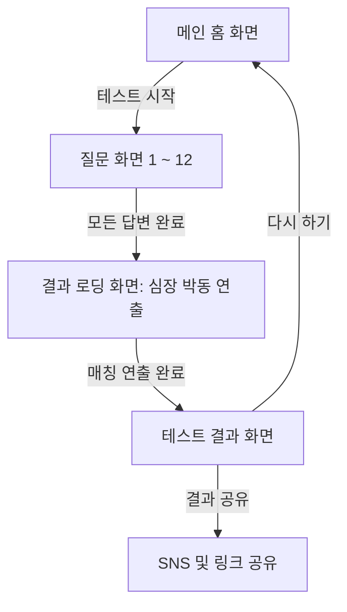

# [요구사항 명세서] 심장을 바쳐라! (Dedicate Your Heart!)

본 문서는 애니메이션 *진격의 거인(Attack on Titan)* 세계관을 기반으로 한 성격/성향 분석 및 캐릭터 매칭 웹 서비스 **'심장을 바쳐라!'**의 웹 서비스 요구사항 명세서(SRS)입니다.

---

## 1. 서비스 개요 (Service Overview)

### 1.1 서비스 정의
* **'심장을 바쳐라!'**는 사용자가 일상적인 상황에 대한 질문들에 답변하면, 그 선택을 기반으로 성격 및 행동 성향을 분석하여 '진격의 거인' 등장인물 중 가장 유사한 성향을 가진 인물을 매칭하고 분석 결과를 제공하는 성향 테스트 웹 서비스입니다.

### 1.2 서비스 목적 및 가치
* **엔터테인먼트 제공**: 일상적인 질문을 통해 사용자의 성향을 파악하고, 이를 '진격의 거인' 캐릭터와 연결하여 흥미를 유발합니다.
* **정교한 매칭 알고리즘**: 단순한 1:1 매칭이 아닌 가중치 기반 배점과 다단계 동점자 처리 로직을 통해 높은 정확도의 결과를 제공합니다.
* **소셜 확산**: 매력적인 결과 카드와 링크 공유 기능을 통해 사용자 간의 소통과 바이럴 효과를 도모합니다.

---

## 2. 사용자 경험 시나리오 (User Journey Map)

1. **진입 (Landing)**: 웅장한 "心臓を捧げよ！" 슬로건과 함께 테스트에 대한 기대감을 높이는 메인 비주얼을 확인합니다.
2. **진단 (Test)**: 4개 카테고리에서 무작위 추출된 총 12개의 질문에 답변합니다.
3. **분석 (Analyzing)**: "영혼과 심장 분석 중..." 문구와 함께 심장 박동 애니메이션이 가미된 로딩 화면을 거칩니다.
4. **결과 (Result)**: 일치하는 캐릭터의 카드, 성향 키워드, 상세 설명, 그리고 최상의/상극의 궁합 캐릭터를 확인합니다.
5. **공유 및 재시도 (Share & Retry)**: 결과 링크를 복사하여 공유하거나 테스트를 처음부터 다시 시작할 수 있습니다.

---

## 3. 기능 요구사항 (Functional Requirements)

### 3.1. 메인 화면 (Home Screen)
* **다국어 슬로건**: 일본어 원어 슬로건(`心臓を捧げよ！`)과 한국어 번역(`심장을 바쳐라!`)을 강렬한 대비 색상으로 배치.
* **참여자 카운터**: 실시간으로 집계된 누적 참전자 수를 노출하여 대세감 형성.
* **배경 연출**: 메인 비주얼 이미지와 붉은색 그라데이션, 펄스 애니메이션을 활용한 웅장한 분위기 조성.

### 3.2. 테스트 진행 화면 (Questions Screen)
* **랜덤 질문 시스템**: 전체 24개 질문 은행 중 카테고리별 3문항씩 총 12문항을 추출하여 매번 새로운 경험 제공.
* **부드러운 전환**: Framer Motion을 활용하여 질문 전환 시 깜빡임 없는 슬라이드 효과 적용.
* **진행 인디케이터**: 현재 질문 번호와 대분류 카테고리, 그리고 시각적인 진행률 게이지 바 제공.

### 3.3. 결과 분석 화면 (Analyzing Screen)
* **몰입형 로딩**: 3.5초간의 심장 박동 애니메이션과 함께 분석 문구 순차 노출.

### 3.4. 결과 화면 (Result Screen)
* **캐릭터 카드**: 고해상도 캐릭터 이미지, 칭호, 이름, 성향 키워드(#태그) 포함.
* **궁합 시스템**: 최고의 동반자와 상극의 인물을 캐릭터 이미지와 함께 시각화.
* **공유 기능**: 현재 결과 캐릭터 파라미터를 포함한 고유 URL 생성 및 클립보드 복사 기능.

---

## 4. 데이터 및 알고리즘 설계 (Data & Algorithm)

### 4.1. 매칭 대상 (20인 구성)
* **캐릭터 (20인)**: 에렌 예거, 미카사 아커만, 아르민 알레르토, 리바이 아커만, 엘빈 스미스, 한지 조에, 장 키르슈타인, 사샤 브라우스, 코니 스프링거, 히스토리아 레이스, 라이너 브라운, 애니 레온하트, 지크 예거, 가비 브라운, 팔코 글라이스, 플록 포르스터, 턱 거인, 차력 거인, 초대형 거인, 갑옷 거인.

### 4.2. 배점 알고리즘 (Scoring System)
본 서비스는 모든 결과의 확률적 균형과 애니메이션 고증을 동시에 충족하기 위해 **'수학적 완전 균등 배점 모델'**을 사용합니다.

1.  **가중치 구조 (Weighted Scoring Matrix)**
    *   각 선택지에는 해당 성향에 부합하는 캐릭터들에게 순차적으로 **5, 4, 3, 2, 1점**의 가중치를 부여합니다.
    *   모든 질문(24문항) 전체에서 각 캐릭터는 **동일한 총점(72점)**과 **동일한 점수 분포**(5점 4회, 4점 4회, 3점 8회, 2점 4회, 1점 4회)를 갖도록 매트릭스가 설계되었습니다.
    *   이를 통해 특정 캐릭터가 과도하게 노출되거나 소외되는 현상을 방지하며, 모든 캐릭터의 당첨 확률을 **약 5%(4~6% 범위)**로 수렴시킵니다.

2.  **질문별 전원 참여 및 균등 추출**
    *   모든 질문의 선택지(A, B, C, D)에는 20명의 캐릭터가 5명씩 반드시 포함되어 사용자의 모든 선택이 결과에 공정하게 기여합니다.
    *   질문 은행은 4개 카테고리로 구성되며, 각 카테고리에서 3문제씩 균등하게 추출하여 특정 성향에 편중되지 않는 중립적인 진단을 수행합니다.

### 4.3. 동점자 해소 규칙 (Tie-Breaking Rules)
12개 문항의 제한된 질문 수 내에서 최고점 동점자가 발생할 경우, 다음의 우선순위에 따라 최종 1인을 확정합니다.

*   **1순위: 가치관(Category 3) 점수 우선**
    *   사용자의 본질적인 신념을 묻는 '가치관 및 신념' 카테고리(Q13~Q18)에서 더 높은 점수를 획득한 캐릭터를 선택합니다. 행동 양식보다 가치관의 공명을 더 중요하게 판단합니다.
*   **2순위: 캐릭터 인지도 및 서열 기반 우선순위**
    *   1순위에서도 동점일 경우, 사전에 정의된 `priorityList`(주인공 및 핵심 인물 순)를 기준으로 최종 캐릭터를 결정하여 오류 없는 결과를 보장합니다.

---

## 5. UI/UX 디자인 가이드

*   **메인 컬러**: Deep Crimson (`#8B0000`), Pure White (`#FFFFFF`), Charcoal Black (`#0A0A0A`).
*   **컴포넌트**: 글래스모피즘(Glassmorphism) 기반의 반투명 카드 레이아웃.
*   **애니메이션**: `framer-motion`을 이용한 부드러운 `easeOut` 효과 및 `layout transition`.

---

## 6. 기술 스택 및 환경

*   **Framework**: Next.js 15 (App Router).
*   **Styling**: Tailwind CSS.
*   **Animation**: Framer Motion, Lucide React Icons.
*   **Database**: Supabase (PostgreSQL) with Drizzle ORM (참전자 통계 저장용).
