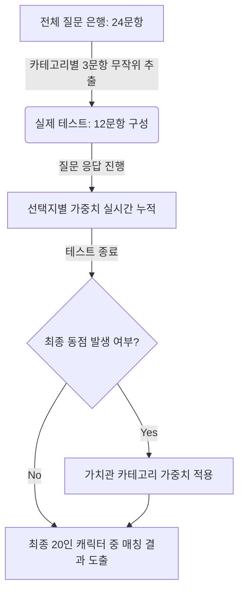

# [성격 진단 기준] 심장을 바쳐라! (Dedicate Your Heart!)

본 문서는 사용자의 성향을 진격의 거인 캐릭터 및 4종의 거인 유형과 매칭하기 위한 **은행식 무작위 질문 풀(Question Pool) 및 균등 배점 알고리즘** 설계서입니다.

---

## 1. 알고리즘 아키텍처 개요 (Algorithm Architecture)

사용자의 답변 피로도를 줄이고 매 테스트마다 새로운 몰입감을 제공하기 위해, **'랜덤 풀링(Random Pooling) 시스템'**과 **'수학적 균등 배점 모델'**을 결합하여 설계하였습니다.



### 1.1 핵심 메커니즘
1. **질문 은행(Question Bank) 구축**: 총 **24개의 고품질 질문**을 4개의 성격 카테고리로 나누어 사전 준비합니다.
2. **랜덤 질문 추출**: 사용자가 테스트를 시작할 때, 각 카테고리당 정확히 **3문항씩 무작위로 추출**되어 **총 12문항**의 커스텀 질문지가 실시간으로 생성됩니다. (중도 이탈율 최소화 및 재참여 유도)
3. **수학적 완전 균등 배점 (Perfect Equi-Scoring)**:
   * **매칭 캐릭터**: 세계관 핵심 인물 16인 및 거인 4종을 포함한 **총 20인**을 최종 결과 풀로 정의합니다.
   * **완벽한 확률 분배**: 모든 캐릭터는 24개 문항 전체에서 **동일한 총점(72점)**과 **동일한 점수 분포(5점 4회, 4점 4회, 3점 8회, 2점 4회, 1점 4회)**를 갖도록 설계되었습니다.
   * **질문별 전원 참여**: 모든 질문에는 20명의 캐릭터가 선택지 A, B, C, D에 5명씩 분산되어 반드시 한 번씩 등장합니다. 이를 통해 어떤 선택지를 고르더라도 모든 캐릭터가 확률적으로 공평한 기회를 얻게 됩니다.
   * **동점자 방지 설계**: 가치관 카테고리(C3) 점수를 모든 캐릭터가 **18점**으로 동일하게 배정하여, 동점자 발생 시에도 특정 캐릭터에게 쏠리지 않도록 2차 랜덤 추출 로직을 보강했습니다.

---

## 2. 매칭 대상 캐릭터 정의 (20인 프로필)

| ID | 이름 | 대표 성향 및 키워드 |
| :--- | :--- | :--- |
| **01** | **에렌 예거** | 자유 갈망, 꺾이지 않는 투지, 다소 극단적 행동력 |
| **02** | **미카사 아커만** | 소중한 사람을 위한 맹목적 헌신, 조용하고 압도적인 실천력 |
| **03** | **아르민 알레르토** | 뛰어난 지적 직관력, 공존과 평화를 꿈꾸는 이상주의 |
| **04** | **리바이 아커만** | 냉철하고 신속한 판단력, 묵묵하게 신뢰를 지키는 해결사 |
| **05** | **엘빈 스미스** | 대담하고 카리스마 넘치는 리더십, 대승적 결단력 |
| **06** | **한지 조에** | 베일에 싸인 진실을 향한 광기 어린 호기심, 유쾌한 실험정신 |
| **07** | **라이너 브라운** | 무거운 의무감, 내면의 모순과 싸우는 고독한 군인 |
| **08** | **히스토리아 레이스** | 타인의 시선에서 벗어나 온전한 자신을 긍정하는 주체성 |
| **09** | **장 키르슈타인** | 현실적인 상황 판단력, 평범하지만 인간적인 리더십 |
| **10** | **사샤 브라우스** | 자유로운 본능과 식탐, 순수하고 가식 없는 친화력 |
| **11** | **코니 스프링거** | 소박하고 의리 넘치는 성품, 팀의 활기를 더하는 무드메이커 |
| **12** | **지크 예거** | 냉소적이고 허무주의적인 통찰력, 거대한 대의를 위한 비밀 설계 |
| **13** | **아니 레온하트** | 냉정하고 합리적인 개인주의, 불필요한 관계를 최소화하는 독립성 |
| **14** | **팔코 그라이스** | 이타적이고 맑은 심성, 적마저 품어 안는 순수한 용기 |
| **15** | **가비 브라운** | 강렬한 애국심과 승부욕, 저돌적으로 목표를 돌파하는 행동력 |
| **16** | **플록 포르스터** | 질서와 권력에 대한 맹목적 추종, 강한 현실주의적 집착 |
| **17** | **턱 거인** | 무조건적인 희생 거부, 마음을 연 대상 한정 물불 가리지 않는 의리 |
| **18** | **차력 거인** | 전술 시야로 아군을 조력하는 든든한 성실함과 묵묵한 인내력 |
| **19** | **초대형 거인** | 세상을 뒤흔들 강력한 위압감 이면의 소극적이고 신중한 영혼 |
| **20** | **갑옷 거인** | 상처 입고 무너질지언정 동료와 임무를 위해 최전선에서 방패막이가 되는 굳건함 |

## 3. 카테고리별 질문 은행 (24가지 무작위 질문 풀)

*(모든 선택지에는 캐릭터별 성향 가중치[5, 4, 3, 2, 1점]가 수학적 매트릭스에 따라 균등하게 배정되어 있습니다.)*

### 카테고리 1: 위기 대처 및 행동 양식 (Q1 ~ Q6)
*본 카테고리에서 무작위로 **3문항**이 출제됩니다.*

**Q1. 예상치 못한 거인의 기습으로 대열이 붕괴되었습니다. 당신의 즉각적인 대처는?**
*   망설임 없이 돌격하여 적을 유인한다.
*   뒤로 물러나 즉시 방어선을 재구축한다.
*   주변의 동료를 어떻게든 최우선으로 보호한다.
*   침착하게 적의 약점을 노려 베어 넘긴다.

**Q2. 작전 도중 중요한 장비가 고장 났을 때, 당신이 문제를 해결하는 스타일은?**
*   기발한 임기응변으로 대체품을 만들어낸다.
*   사령부 매뉴얼을 준수해 차근차근 수리한다.
*   직관과 감각을 믿고 직접 두드려 맞춘다.
*   전문가에게 장비를 맡기고 지원 업무에 집중한다.

**Q3. 불가능해 보이는 극비 임무의 돌격 대장직을 제안받았다면?**
*   무거운 책임을 짊어지고 대담하게 수락한다.
*   임무의 성공 확률을 철저히 계산한 뒤 결정한다.
*   묵묵히 내가 해야 할 의무이기에 받아들인다.
*   가장 자유로운 방식을 쓸 수 있다면 수락한다.

**Q4. 작전 중 고립되어 보급이 끊겼을 때, 당신이 보이는 행동은?**
*   뛰어난 생존 본능으로 어떻게든 사냥해 먹고산다.
*   동료들이 지치지 않도록 밝은 에너지를 준다.
*   에너지를 보존하며 묵묵히 구조를 기다린다.
*   탈출 통로를 개척하기 위해 쉬지 않고 파헤친다.

**Q5. 나를 시기하고 견제하는 적대적인 부대원들과 갈등이 발생했을 때?**
*   압도적인 실력으로 그들의 불만을 잠재운다.
*   대화를 통해 오해를 풀고 합의점을 찾는다.
*   대의를 위해 그들의 견제쯤은 가볍게 무시한다.
*   상대의 약점을 쥐고 조용히 판을 설계한다.

**Q6. 평화롭고 조용한 일상 속에서 돌연 비상 종소리가 울릴 때 당신의 뇌리를 스치는 생각은?**
*   "드디어 나의 힘과 칼날을 증명할 때다."
*   "제발 아무도 다치지 않고 무사히 끝나기를..."
*   "일단 비상 식량부터 단단히 챙겨두자."
*   "또 무의미한 소모전이 반복되는 것인가..."

---

### 카테고리 2: 인간관계 및 소통 방식 (Q7 ~ Q12)
*본 카테고리에서 무작위로 **3문항**이 출제됩니다.*

**Q7. 새로운 동료들과 처음 만나 친해질 때 당신이 보여주는 스탠스는?**
*   먼저 살갑게 말을 걸고 장난을 치며 벽을 깬다.
*   적당한 거리를 유지하며 상대방을 조용히 관찰한다.
*   든든한 맏형처럼 그들의 필요나 고충을 챙겨준다.
*   그들의 독특한 성향에 흥미를 느끼고 호기심을 보인다.

**Q8. 정말 믿었던 동료가 나에게 상처를 주거나 나를 기만했음을 알았을 때?**
*   배신에 깊이 분노하며 확실하게 척결하려 한다.
*   왜 그런 선택을 했는지 그의 심리와 사정을 파고든다.
*   대의와 조직의 안정을 위해 내 개인적 감정을 참는다.
*   배신한 자보다 남아있는 소중한 사람들을 더 지킨다.

**Q9. 누군가 당신에게 원치 않는 영웅적인 페르소나나 희생을 요구한다면?**
*   타인의 억압적인 시선이나 기대를 과감히 거부한다.
*   내 희생이 더 큰 가치를 가져온다면 기꺼이 받아들인다.
*   앞에서는 맞춰주는 척하며 뒤로는 독자 노선을 간다.
*   내 소중한 사람이 위험해지지 않는 선에서 타협한다.

**Q10. 동료가 극한의 두려움으로 전장에서 패닉에 빠져 눈물을 흘리고 있다면?**
*   용기와 자신감을 심어주며 든든하게 다독인다.
*   그 공포에 따뜻하게 온전히 공감하고 위로해 준다.
*   나약함은 해가 되니 정신 차리라고 냉정하게 꾸짖는다.
*   엉뚱한 화제를 던져 패닉으로부터 주위를 돌린다.

**Q11. 누군가에게 미움을 받거나 집단에서 고립되는 상황에 처했을 때 당신은?**
*   타인의 시선은 무시하고 나의 목표와 고독을 즐긴다.
*   마음을 열고 소통하며 갈등의 벽을 서서히 허문다.
*   나의 나약함을 탓하며 더 처절하게 능력 단련에 매진한다.
*   슬픈 감정을 애써 쾌활한 웃음으로 숨기고 가장한다.

**Q12. 나보다 뛰어난 능력을 가졌거나 급격하게 승진하는 동료를 보았을 때?**
*   나의 모자람을 절감하며 그를 넘기 위해 밤낮으로 단련한다.
*   그의 전술적 강점을 내 작전에 어떻게 활용할지 연구한다.
*   순수하게 동료의 재능을 축하하고 존경의 뜻을 보낸다.
*   그가 짊어질 막중한 책임을 알기에 부러워하지 않는다.

---

### 카테고리 3: 가치관 및 신념 (Q13 ~ Q18)
*본 카테고리에서 무작위로 **3문항**이 출제됩니다.*

**Q13. 세상을 뒤흔들 수 있는 절대적인 진실(비밀)을 마주했을 때 당신의 선택은?**
*   큰 혼란이 올지라도 투명하게 모든 대중에게 밝힌다.
*   진실을 나만 짊어지고 강력한 질서와 통제를 위해 쓴다.
*   세상이 어찌 되든 소중한 이들의 일상을 지키는 데 쓴다.
*   부조리한 비극의 연쇄를 근본적으로 끊어내는 데 쓴다.

**Q14. 대의를 위해 무고한 소수의 민간인이 희생되어야만 하는 딜레마가 찾아왔다면?**
*   악마라 비난받을지라도 승리를 위해 차갑게 작전을 승인한다.
*   어떻게든 희생을 단 1%라도 줄일 대안을 필사적으로 찾는다.
*   이런 잔혹함을 당연시하는 불합리한 룰 자체를 부순다.
*   차라리 나 스스로를 희생하여 그들의 짐을 짊어진다.

**Q15. 당신이 생각하는 가장 가치 있는 '자유'의 정의는 무엇인가요?**
*   벽 밖의 미지의 세상을 그 누구의 억압도 없이 누비는 것.
*   강요된 역할에서 벗어나 떳떳한 나 자신으로 서는 것.
*   소중한 사람들과 맛있는 음식을 나눠 먹는 소박한 평화.
*   거대한 질서 아래 확실한 평온과 국토를 보장받는 것.

**Q16. 역사와 권력이 승자에 의해 왜곡되고 포장되어 전해지는 것에 대해?**
*   힘을 쥐고 살아남아 승리하는 자가 정의를 쓰는 법이다.
*   보이지 않는 이면의 진실과 도덕적 모순을 파헤쳐 성찰한다.
*   역사적 거대 담론보다 내 눈앞의 인간다운 아픔이 중요하다.
*   오늘 내가 살아남아 먹고 숨 쉬는 것 이상의 진실은 없다.

**Q17. 누군가에게 복수를 감행할 수 있는 절대적인 칼자루가 손에 쥐어졌을 때?**
*   내 권리와 삶을 유린한 상대의 가슴에 주저 없이 칼을 꽂는다.
*   증오의 굴레를 내 선에서 멈추고 관용과 대화를 택한다.
*   감정에 흔들리지 않고 나의 실리와 철저한 미래 이익에 맞춰 처리한다.
*   사적 증오 대신 내게 부여된 냉혹한 의무로서 단죄를 완수한다.

**Q18. 한 번뿐인 인생에서 당신이 가장 지키고 싶은 절대적인 가치는?**
*   소중한 사람과의 어떠한 역경도 이겨낼 끈끈한 연대.
*   세상의 모든 수수께끼를 풀고 알아낼 학술적인 탐구.
*   조국의 위상과 신념을 드높이는 눈부신 명예와 훈장.
*   추악한 타협에 결코 굴복하지 않는 깨끗한 신념.

---

### 카테고리 4: 내면의 상처와 스트레스 극복 (Q19 ~ Q24)
*본 카테고리에서 무작위로 **3문항**이 출제됩니다.*

**Q19. 극심한 스트레스와 멘탈 붕괴의 위기가 찾아왔을 때 나타나는 당신의 태도는?**
*   약점을 보이지 않기 위해 오히려 기행이나 장난을 친다.
*   방에 틀어박혀 침착하고 차갑게 고독을 정리 정돈한다.
*   신뢰하는 동료에게 털어놓고 의지하며 극복한다.
*   인간적인 감정을 지우고 완벽하게 임무만 수행하는 기계가 된다.

**Q20. 꿈꾸던 미래가 완전히 박살 나고 절망의 구렁텅이에 빠졌을 때?**
*   분노하며 적에게 칼날을 돌려 철저하게 물어뜯어 재기한다.
*   나락 속에서 스스로를 혐오하고 자책하며 한없이 침잠한다.
*   세상을 원래 그런 부조리한 곳이라 치부하며 기대를 거둔다.
*   눈물을 닦고 내가 당장 할 수 있는 소박한 일부터 시작한다.

**Q21. 동료들에게 들키고 싶지 않은 당신만의 가장 깊은 약점(콤플렉스)은?**
*   든든한 리더인 척하지만 속으론 외면받을까 두려워하는 나약함.
*   모든 이에게 언제나 착한 사람으로 남아야 한다는 심각한 강박.
*   나만의 비전이나 대의가 없어 대세를 쉽게 추종하는 평범함.
*   감정에 휩쓸려 일을 그르칠까 봐 의도적으로 타인과 벽을 두는 점.

**Q22. 나에게 단 하루의 완벽한 자유시간(포상 휴가)이 주어진다면?**
*   평소 먹고 싶었던 진귀한 요리를 배부르게 즐긴다.
*   조용히 방에서 책을 읽거나 흥미로운 지적 탐구를 즐긴다.
*   방 청소와 장비 정리를 완벽히 마치며 카타르시스를 즐긴다.
*   소박하게 동료들과 구기종목 스포츠나 가벼운 여가를 보낸다.

**Q23. 인생의 마지막 불꽃이 꺼져가는 임종의 순간, 당신의 마지막 독백은?**
*   "나는 어떤 굴복도 하지 않았고, 끝까지 싸웠다."
*   "내 죽음이 다음 병사들의 길잡이가 될 이정표이기를..."
*   "내가 깊이 사랑했던 그가 내 몫까지 행복하게 살기를..."
*   "지옥 같은 책임과 의무에서 벗어나 비로소 안식하는구나."

**Q24. 나 자신보다 뛰어난 대세를 맹신하며 뒤늦게 후회했던 상처에 대해?**
*   나약함을 떨치고 스스로 판단하고 결정하는 주체적 삶을 살겠다.
*   상처마저 내 일부로 안고서라도 거대한 정의에 나를 던지겠다.
*   살아남았음에 감사하며 묵묵히 남은 사람들의 든든한 버팀목이 되겠다.
*   대세의 거대한 흐름에 나를 굴복시키고 순응하는 법을 배운다.

---

## 4. 백엔드/프론트엔드 매칭 알고리즘 구현 로직

### Step 1. 질문 생성 (Question Generation)
*   사용자가 테스트 시작 버튼을 누르면 다음 자바스크립트/타입스크립트 로직을 통해 12문항을 실시간 추출합니다.
```typescript
const categories = ['C1', 'C2', 'C3', 'C4'];
let testQuestions = [];

categories.forEach(cat => {
  // 각 카테고리별 질문 풀에서 3개씩 무작위 비복원 추출
  const catPool = allQuestions.filter(q => q.category === cat);
  const shuffled = catPool.sort(() => 0.5 - Math.random());
  testQuestions.push(...shuffled.slice(0, 3));
});

// 추출된 12문항을 무작위 순서로 재배열
testQuestions = testQuestions.sort(() => 0.5 - Math.random());
```

### Step 2. 실시간 가점 적립
*   사용자 응답 시 선택지에 바인딩된 캐릭터별 가중치를 누적합니다.
*   각 선택지에는 해당 성향에 가장 부합하는 캐릭터들부터 순차적으로 **5, 4, 3, 2, 1점**이 배정되어 있습니다.
*   모든 질문에는 20명의 캐릭터가 반드시 포함되어 있어, 사용자의 모든 선택이 결과에 세밀하게 반영됩니다.

### Step 3. 최종 동점자 해소 규정 (Tie-Breaking Rule)
12개 문항만 출제되므로 최고점 동점자가 발생할 확률이 있습니다. 동점 발생 시 다음 순위로 판별합니다.
1. **가치관 카테고리(Category 3) 질문**에서 얻은 점수가 더 높은 캐릭터를 우선 매칭합니다.
2. 1번으로도 해결되지 않을 경우, 캐릭터의 고유 **가중치 보정값** 또는 사전 설정된 **서열 인지도**를 기준으로 우선순위를 지정해 에러 없이 최종 1인을 반환합니다.